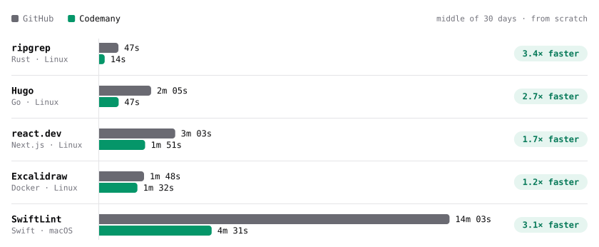
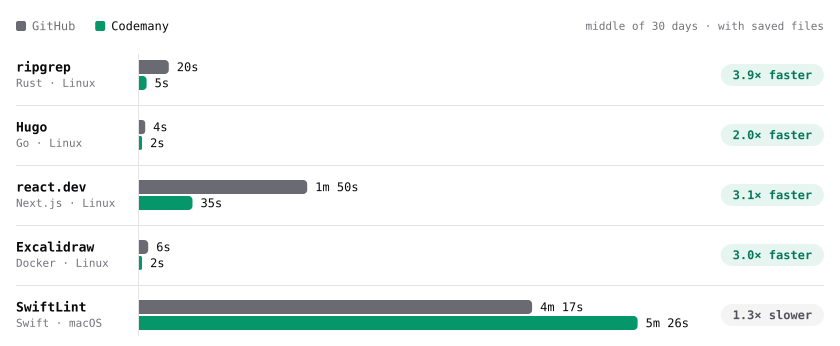
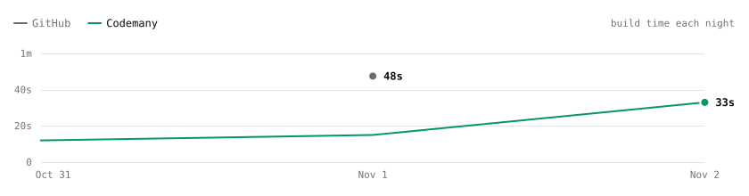
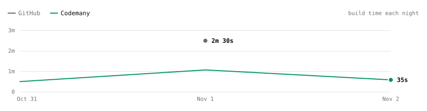
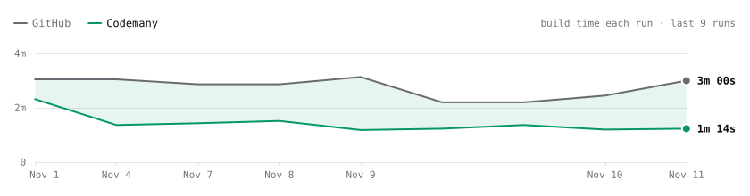
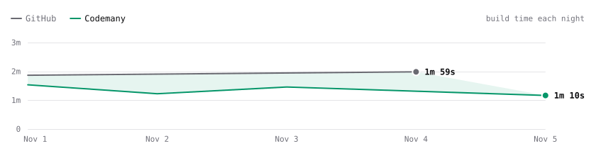
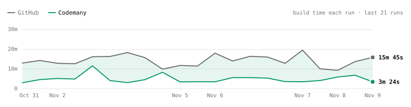

# Codemany Bench

Every night we build the same code twice: once on GitHub's computer, once on a small [Codemany](https://codemany.com) computer. **The shorter bar wins.**

<picture>
  <source media="(prefers-color-scheme: dark)" srcset="charts/speed-cold-dark.svg">
  
</picture>

**Green is Codemany. Black is GitHub.** The full page is at **[codemany.com/benchmarks](https://codemany.com/benchmarks)**.

## Who is faster?

<!-- bench:start -->
Time to build each project from scratch, for **private code** (the middle of the last 30 days). Updated 2026-11-02.

| Project | GitHub | Codemany | Codemany is… | Check it |
| --- | --- | --- | --- | --- |
| ripgrep | 48s | 14s | **3.5× faster** | GitHub (private run) · [Codemany](https://github.com/codemanyhq/bench/actions/runs/41189686531/job/124809425428) |
| Hugo | 2m 30s | 47s | **3.2× faster** | GitHub (private run) · [Codemany](https://github.com/codemanyhq/bench/actions/runs/41189686531/job/124809425392) |
| react.dev | 3m 05s | 1m 47s | **1.7× faster** | GitHub (private run) · [Codemany](https://github.com/codemanyhq/bench/actions/runs/41189686531/job/124809425512) |
| Excalidraw | 1m 52s | 1m 32s | **1.2× faster** | GitHub (private run) · [Codemany](https://github.com/codemanyhq/bench/actions/runs/41189686531/job/124809425519) |
| SwiftLint | 13m 32s | 3m 44s | **3.6× faster** | [GitHub](https://github.com/codemanyhq/bench/actions/runs/41189686531/job/124809425564) · [Codemany](https://github.com/codemanyhq/bench/actions/runs/41189686531/job/124809425335) |

Public code? GitHub runs it for free, on a bigger Linux computer. See **More numbers**.

<b>More numbers</b>: public code, with saved files, prices, night by night

### Private code, from scratch

| Project | GitHub | Codemany | Result | GitHub price¹ |
| --- | --- | --- | --- | --- |
| ripgrep | 48s | 14s | 3.5× faster | $0.01 |
| Hugo | 2m 30s | 47s | 3.2× faster | $0.02 |
| react.dev | 3m 05s | 1m 47s | 1.7× faster | $0.02 |
| Excalidraw | 1m 52s | 1m 32s | 1.2× faster | $0.01 |
| SwiftLint | 13m 32s | 3m 44s | 3.6× faster | $0.86 |

### Private code, with saved files

<picture>
  <source media="(prefers-color-scheme: dark)" srcset="charts/speed-warm-dark.svg">
  
</picture>

| Project | GitHub | Codemany | Result | GitHub price¹ |
| --- | --- | --- | --- | --- |
| ripgrep | 30s | 14s | 2.2× faster | $0.01 |
| Hugo | 51s | 33s | 1.5× faster | $0.01 |
| react.dev | 2m 34s | 2m 13s | 1.2× faster | $0.02 |
| Excalidraw | 2m 30s | 2m 28s | about the same | $0.02 |
| SwiftLint | 12m 00s | 6m 06s | 2.0× faster | $0.77 |

### Public code (free on GitHub), from scratch

| Project | GitHub | Codemany | Result |
| --- | --- | --- | --- |
| ripgrep | 27s | 14s | 2.0× faster |
| Hugo | 57s | 47s | 1.2× faster |
| react.dev | 2m 00s | 1m 47s | 1.1× faster |
| Excalidraw | 1m 20s | 1m 32s | 1.2× slower |
| SwiftLint | 13m 32s | 3m 44s | 3.6× faster |

### Public code (free on GitHub), with saved files

| Project | GitHub | Codemany | Result |
| --- | --- | --- | --- |
| ripgrep | 16s | 14s | 1.2× faster |
| Hugo | 41s | 33s | 1.2× faster |
| react.dev | 1m 34s | 2m 13s | 1.4× slower |
| Excalidraw | 1m 42s | 2m 28s | 1.5× slower |
| SwiftLint | 12m 00s | 6m 06s | 2.0× faster |

### Night by night (private code, from scratch)

**ripgrep**

<picture>
  <source media="(prefers-color-scheme: dark)" srcset="charts/trend-ripgrep-dark.svg">
  
</picture>

**Hugo**

<picture>
  <source media="(prefers-color-scheme: dark)" srcset="charts/trend-hugo-dark.svg">
  
</picture>

**react.dev**

<picture>
  <source media="(prefers-color-scheme: dark)" srcset="charts/trend-react-dev-dark.svg">
  
</picture>

**Excalidraw**

<picture>
  <source media="(prefers-color-scheme: dark)" srcset="charts/trend-excalidraw-dark.svg">
  
</picture>

**SwiftLint**

<picture>
  <source media="(prefers-color-scheme: dark)" srcset="charts/trend-swiftlint-dark.svg">
  
</picture>

¹ What one GitHub build costs for private code, at the prices in [The computers](#the-computers). Public code is free.

<!-- bench:end -->

## The computers

<!-- computers:start -->
You buy a Codemany computer once and keep it.

| Our computer | What's inside | Get one |
| --- | --- | --- |
| Mini PC (Linux) | 8 cores, 32 GB memory, 1 TB disk | [Get one](https://www.amazon.com/dp/B0DRVSK2T9) (MINISFORUM UM870, 32 GB, 1 TB) |
| Mac mini (macOS) | 12 cores, 16 GB memory, 256 GB disk | [Get one](https://www.amazon.com/dp/B0HGGJZ92H) (M6, 16 GB, 256 GB) |

You rent a GitHub computer by the minute. What you get depends on your code.

**For private code**

| GitHub's computer | What's inside | Price per minute |
| --- | --- | --- |
| `ubuntu-latest` (Linux) | 2 cores, 7 GB memory, 14 GB disk | [$0.006](https://docs.github.com/en/billing/reference/actions-runner-pricing) |
| `macos-latest` (macOS) | 3 cores (Apple M1), 7 GB memory, 14 GB disk | [$0.062](https://docs.github.com/en/billing/reference/actions-runner-pricing) |

**For public code (free)**

| GitHub's computer | What's inside | Price per minute |
| --- | --- | --- |
| `ubuntu-latest` (Linux) | 4 cores, 16 GB memory, 14 GB disk | Free |
| `macos-latest` (macOS) | 3 cores (Apple M1), 7 GB memory, 14 GB disk | Free |

Checked 2026-11-01 on GitHub's [price list](https://docs.github.com/en/billing/reference/actions-runner-pricing) and [computer list](https://docs.github.com/en/actions/reference/runners/github-hosted-runners).
<!-- computers:end -->

## Fair and true

We show the real time and the real price. We don't make GitHub or Codemany look better than they are.

- **Private code first.** That's the code teams pay for, so the tables show it first.
- **Private times come twice a week.** GitHub gives private code a smaller Linux computer (2 cores). The only way to get that computer is to build from a private project. So a private copy of this test runs every Sunday, and we copy its times here.
- **Public code is free on GitHub.** It gets a bigger Linux computer (4 cores). Those times are under **More numbers**. Macs are the same for both.
- **Same code, same steps.** Both sides build the exact same version, with the project's own build command and the same tools.
- **You can check.** Each time links to its real run on GitHub. Only the private runs can't be opened, because that project is private.
- **Codemany costs $20 a month** for 2 computers. Codemany runs on a computer you own. That computer isn't in this price.

<b>How we test, in detail</b>

### What we build

<!-- projects:start -->
| Project | Language | Computer | Build command | Exact commit |
| --- | --- | --- | --- | --- |
| [ripgrep](https://github.com/BurntSushi/ripgrep) | Rust | Linux | `cargo build --release` | [`91f5d22`](https://github.com/BurntSushi/ripgrep/commit/91f5d22ef48bde459d90a8c7dbeab416e97d0f2b) |
| [Hugo](https://github.com/gohugoio/hugo) | Go | Linux | `go install` | [`8502b60`](https://github.com/gohugoio/hugo/commit/8502b60066b1059c0e24275ef8a3b642b1b2a10b) |
| [react.dev](https://github.com/reactjs/react.dev) | Next.js | Linux | `yarn install --frozen-lockfile && next build` | [`0821e7d`](https://github.com/reactjs/react.dev/commit/0821e7d9428a6c58c922765b891bbffba9ed6249) |
| [Excalidraw](https://github.com/excalidraw/excalidraw) | Docker | Linux | `docker build -t excalidraw .` | [`a758e93`](https://github.com/excalidraw/excalidraw/commit/a758e93d6a03e9f995973703cb886850a398a6d3) |
| [SwiftLint](https://github.com/realm/SwiftLint) | Swift | macOS | `swift build -c release --product swiftlint` | [`ec4691d`](https://github.com/realm/SwiftLint/commit/ec4691d9e813a1d3358e82917326b56b0a71d3c9) |
| [TypeScript 7 compiler](https://github.com/microsoft/TypeScript) *(new: results appear after 3 clean nights)* | Node.js | Linux | `npm ci && npx hereby build` | [`6161772`](https://github.com/microsoft/TypeScript/commit/6161772c1370bdd4a82f808e6823bd755eb1870d) |
| [Ruff](https://github.com/astral-sh/ruff) *(new: results appear after 3 clean nights)* | Rust | Linux | `cargo build --release --locked --bin ruff` | [`049c351`](https://github.com/astral-sh/ruff/commit/049c351befba87447d3d50a2ee3d617ce3c2a264) |
| [Django tests](https://github.com/django/django) *(new: results appear after 3 clean nights)* | Python | Linux | `pip install -r tests/requirements/py3-free-threading.txt -e . && python -Wall tests/runtests.py` | [`a05e16a`](https://github.com/django/django/commit/a05e16a7230fe33d3f43f4a3aaed103cebb42efc) |
| [Kubernetes (kubectl)](https://github.com/kubernetes/kubernetes) *(new: results appear after 3 clean nights)* | Go | Linux | `make WHAT=cmd/kubectl` | [`aa8de06`](https://github.com/kubernetes/kubernetes/commit/aa8de068063335aee4a78589ee0d5c70b448e266) |
| [Firefox for iOS](https://github.com/mozilla-mobile/firefox-ios) *(new: results appear after 3 clean nights)* | iOS | macOS | `./bootstrap.sh firefox && xcodebuild build-for-testing -scheme Fennec (iOS Simulator)` | [`167e2d2`](https://github.com/mozilla-mobile/firefox-ios/commit/167e2d22f55c47bcaad32dd5d95804b7f7a924a6) |
| [Composable Architecture tests](https://github.com/pointfreeco/swift-composable-architecture) *(new: results appear after 3 clean nights)* | Swift | macOS | `xcodebuild test -scheme ComposableArchitecture -destination platform=macOS` | [`bb175b5`](https://github.com/pointfreeco/swift-composable-architecture/commit/bb175b544d019c7f23a2e41ae29d8c70592aeb58) |
| [Now in Android](https://github.com/android/nowinandroid) *(new: results appear after 3 clean nights)* | Android | Linux | `./gradlew :app:assemble -PminifyWithR8=false` | [`2982e63`](https://github.com/android/nowinandroid/commit/2982e63cb691ad49cd009aab43dc206fee6699c2) |
| [Neovim](https://github.com/neovim/neovim) *(new: results appear after 3 clean nights)* | C | Linux | `cmake --preset ci -D CMAKE_BUILD_TYPE=Release && cmake --build build` | [`2fc7032`](https://github.com/neovim/neovim/commit/2fc7032df9e7b7e4d625cc205a5ff9cdb0f02b27) |
<!-- projects:end -->

### From scratch, and with saved files

Builds keep files around to go faster next time (a *cache*).

| How | What it means |
| --- | --- |
| From scratch | Every saved file is thrown away first, on both computers. |
| With saved files | Last night's files are kept (private Linux: last week's). GitHub downloads them; Codemany already has them. |

### What we time

- Only the `build` step. Getting tools and saved files ready happens before the clock starts, on both sides.
- Codemany builds one project at a time, so each build gets the whole computer, like a fresh GitHub computer does.
- Public builds start every night at 03:17 UTC. Private Linux builds start on Sundays and Wednesdays at 05:17 UTC.

### Check it yourself

1. Open the [bench runs](https://github.com/codemanyhq/bench/actions/workflows/bench.yml).
2. Pick a job, like `ripgrep · codemany · cold`.
3. Open its `build` step. That time is the number in our table.

Private Linux times come from `codemanyhq/bench-private`. It runs the same `github` job as [`bench.yml`](.github/workflows/bench.yml), with this repo's scripts, on GitHub's computer for private code. Only we can open its runs.

The raw numbers are in [`data/results.json`](data/results.json); [`scripts/collect.mjs`](scripts/collect.mjs) reads them from GitHub. To run it yourself, fork this repo and connect a self-hosted runner with the labels `self-hosted`, `Linux` (or `macOS`) and `codemany`.

### Safety

This repo never runs code from strangers: it runs only on a timer or the **Run workflow** button, never on pull requests. Builds get a read-only token. The collector reads the private copy with a read-only token, and only commits `data/`, `charts/` and this README. Every outside action and project is pinned to an exact commit.

## License

[MIT](LICENSE)
